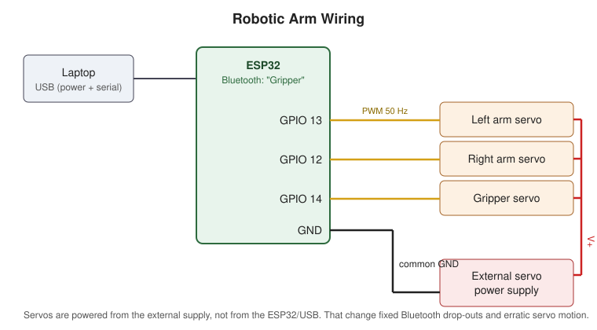

# Bluetooth-Controlled Robotic Arm (ESP32)

A three-servo robotic arm with a gripper. It is controlled wirelessly from a laptop keyboard over Bluetooth. I designed the arm in Onshape and wrote the ESP32 firmware in C++ (Arduino IDE).

Built for **Engineering Design and Tools** at Lewis University, Spring 2026.

<!-- Add a photo or GIF of the working arm here, e.g.:

-->

## Features

- **Wireless control:** the ESP32 runs Classic Bluetooth serial (device name `Gripper`). Commands can also be sent over USB serial.
- **Coordinated two-servo motion:** the arm uses a pantograph-style linkage, so each movement drives both arm servos at the same time.
- **Smooth motion:** servos move 1° at a time every 15 ms. Timing uses `millis()` and `yield()` instead of a long blocking `delay()`.
- **Software angle limits:** every target angle is clamped to a safe range (arm 20–160°, gripper 20–70°) so the servos never drive the linkage into a hard stop.
- **Home command:** `H` returns all servos to their home position.
- **Position feedback:** after every command, the current servo angles are sent back over Bluetooth and USB.

## Controls

| Key | Action |
|-----|--------|
| `W` | Arm up |
| `S` | Arm down |
| `A` | Arm forward |
| `D` | Arm backward |
| `O` | Open gripper |
| `C` | Close gripper |
| `H` | Return to home position |

Commands are case-insensitive.

## Hardware

- ESP32 development board
- 3 hobby servos (left arm, right arm, gripper)
- External power supply for the servos
- Arm structure modeled in Onshape (base, base wall, two arm links, gear pair, gripper)

### Wiring



| Signal | ESP32 pin |
|--------|-----------|
| Left arm servo | GPIO 13 |
| Right arm servo | GPIO 12 |
| Gripper servo | GPIO 14 |

Servo PWM: 50 Hz, 500–2400 µs pulse range.

## How the arm moves

The two arm servos are linked mechanically, so neither one can move without affecting the other. To move the arm **up or down**, the servos turn in opposite directions. To move it **forward or backward**, they turn in the same direction. `moveArmDual()` steps both servos together, one degree at a time, so the linkage moves smoothly instead of jumping.

## Problems we solved

1. **Bluetooth kept disconnecting.** At first the servos were powered from the laptop's USB port through the ESP32. With the Bluetooth radio and three servos running, USB could not supply enough current and the ESP32 dropped the connection. We moved the servos to an external power supply, which fixed the disconnections and the erratic servo motion.
2. **The arm moved on its own.** Because of the linkage, commanding one servo also moved the other part of the arm, and a servo could get stuck at its limit. We changed the control logic so that every movement drives both servos together in the correct directions.
3. **Finding safe angle limits.** We found the angle ranges by testing repeatedly, then enforced them in software with `clampValue()`.

## Getting started

1. Install the [Arduino IDE](https://www.arduino.cc/en/software) and the **ESP32 board package** (Boards Manager → "esp32" by Espressif).
2. Install the **ESP32Servo** library (Library Manager).
3. Open `firmware/robotic_arm/robotic_arm.ino`, select your ESP32 board and port, and upload.
4. Power the servos from the external supply.
5. Pair your computer with the Bluetooth device **`Gripper`** and open a serial terminal on its port. The Arduino Serial Monitor or PuTTY both work. Type the command keys.

## Repository structure

```
robotic-arm-esp32/
├── firmware/robotic_arm/robotic_arm.ino   ESP32 firmware (C++)
├── cad/robotic_arm_assembly.step          Full arm assembly exported from Onshape
├── docs/wiring.svg                        Wiring diagram
└── README.md
```

The STEP file opens in Onshape, Fusion 360, SolidWorks, FreeCAD, or any online STEP viewer.

## My role

- Built the complete 3D model and assembly in Onshape (dimensions and gear mechanism provided by the course).
- Wrote the first version of the firmware.
- Debugged and refined the firmware and hardware with my teammate until the arm worked reliably.

## Author

**Juan Jose Castro**: CAD design, firmware, testing. Developed as a team project.

## License

MIT. See [LICENSE](LICENSE).
